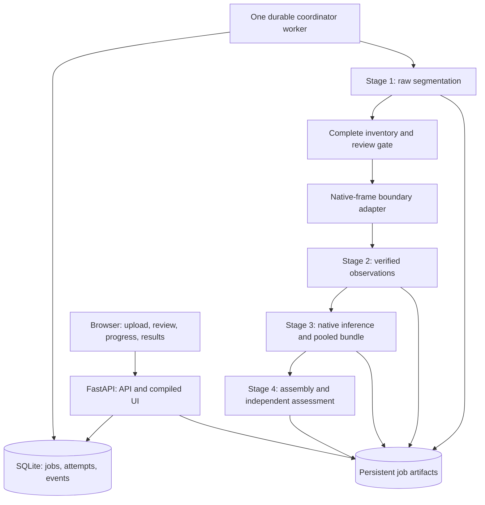

# Paper reconstruction orchestrator and GUI: recommended plan

Implementation note: the local v0.1.0 application is now implemented. See `README.md` and `docs/VALIDATION.md` for its current behavior and measured checks. The remainder of this document preserves the original design investigation.

Research date: 28 October 2026. This is an implementation plan, not a completed application or a qualified Docker image. Commands and proposed filenames below describe the intended interface unless explicitly identified as existing stage commands.

## Recommendation and scope

Build one Linux amd64, CPU-default image containing a Python API, one durable pipeline worker, a browser UI, the four selected stage packages, their frozen models, and isolated Python environments. Run stages as internal subprocesses exchanging verified files. Users should need Docker and a browser; they should not install Python, Node, Git LFS, Torch or stage repositories on their host.

Use FastAPI, React with TypeScript and Vite, SQLite, and a small explicit coordinator. Compile the UI to static assets served by FastAPI. Start with one reconstruction job at a time. The four algorithm stages already have suitable process/file boundaries; adding four HTTP services would add deployment work without helping this initial application.

Resolve the latest **compatible composition** before building, save exact identities, build and test that candidate, and produce a self-contained image. A running image uses its installed versions. Updating a teammate's stage creates a new image; existing jobs retain their original versions and artifacts.

The handoff was treated as project evidence and architectural suggestions. Its embedded starter instructions were not treated as additional user requests. This investigation independently refreshed remote branches, tags, releases and PR states, cloned the selected sources, read the root and nested READMEs, compared the historical embedded READMEs, and examined integration manifests, runtime entry points, the Stage 1 editor and the boundary adapter. No upstream repository was changed and no PR was merged.

## What is actually ready

Live GitHub metadata and Git refs agree with the supplied handoff:

| Component | Current v2 source to use | Default branch / release situation | Meaning for the orchestrator |
| --- | --- | --- | --- |
| Stage 1 | `codex/v2-integration`, `a0e0fae627f16910065471cf1e829bcb1e2a9685` | PR 1 is open and draft. Main remains `16be57b...`, tagged v1.0.1. Latest published release is v1.0.0. | v2 distribution exists in the PR; it is not a stable published v2 release. |
| Stage 2 | `codex/v2-integration`, `8b095867f1eea7216920196fd36c08a4f57b2820` | PR 1 is open and draft. Main remains `84c36be...`, tagged v1.0.2. No published GitHub Release. | Same development-pin exception is needed. |
| Stage 3 | v2.0.0, `38bf18a42d0e1f74470f60f137720ae15a6b6e5d` | Main and the peeled v2.0.0 tag agree; a release is published. | Suitable stable source. |
| Stage 4 | v2.0.5, `919f206772984798a317b40d53443ded6529ceff` | Main and the peeled v2.0.5 tag agree; a release is published. | Use its solver component and shared contract, preserving the historical upstream snapshots. |

Sources: [Stage 1 PR](https://github.com/DanielKatzman/paper-segmentation-stage/pull/1), [Stage 2 PR](https://github.com/DanielKatzman/paper-reconstruction-stage2/pull/1), [Stage 3 release](https://github.com/DanielKatzman/paper-reconstruction-stage3/releases/tag/v2.0.0), [Stage 4 release](https://github.com/DanielKatzman/paper-reconstruction-stage4/releases/tag/v2.0.5). The full live response is saved in `research/REMOTE_AUDIT.json`.

Distribution, algorithm, model and wire-schema versions are separate. Stage 1 distribution 2.0.0 retains core 1.0.0 and SegFormer v3. Stage 2 distribution 2.0.0 retains producer 1.0.2 and model release 1.0.0. Stage 3 distribution 2.0.0 retains core 0.9.32 / unit-scale-v5. Stage 4 umbrella 2.0.5 contains solver package 0.1.0. These differing labels are expected.

There is an additional compatibility wrinkle: Stage 3's manifest explicitly names the old Stage 2 v1.0.2 commit. Stage 2's new v2 wrapper preserves the authenticated model/release data, and the handoff records a separate successful integration of that newer distribution. Record this particular accepted tuple in the orchestrator's compatibility catalog. Matching major version numbers or comparing only version strings would not establish compatibility.

The supplied receipts report fresh four-stage generated-capture CPU controls on Windows and Ubuntu/WSL, each yielding one supported four-piece assembly. That is useful interoperability evidence. It is not a tested container, a completed web application, or a general real-photo accuracy guarantee. The separate six-piece real-capture review measures Stage 4 on saved upstream evidence; the fourteen-case 4–30-piece development cohort also reuses upstream evidence.

Sources: the supplied `ORCHESTRATOR_HANDOFF.md` and `provenance/INTEGRATION_VALIDATION.json`; [Stage 3 compatibility](https://github.com/DanielKatzman/paper-reconstruction-stage3/blob/38bf18a42d0e1f74470f60f137720ae15a6b6e5d/compatibility.json); [current capture review](https://github.com/DanielKatzman/paper-reconstruction-stage4/blob/919f206772984798a317b40d53443ded6529ceff/docs/V204_CAPTURE_ALIGNMENT_REVIEW.md).

## Architecture



All boxes except the browser and Docker's storage live inside one runtime container. An init process starts a small supervisor, which owns one API process and one coordinator process. Each stage runs only when needed, using its assigned interpreter. A supervisor failure or dead worker must affect readiness; a working HTTP server alone does not prove jobs can run. Use one API worker initially and keep scheduling in the dedicated coordinator.

SQLite is the durable authority for job state. `status.json`, if supplied for exports, is a derived snapshot. Stage manifests and checksums are the authority for stage publications. The worker reconciles the database against those publications after a restart. This is recoverable execution, not a claim of transactional exactly-once computation across SQLite and subprocesses.

FastAPI's request-level background tasks are insufficient as the durable queue for this application. Use a SQLite-backed queue and explicit worker lifecycle. The FastAPI documentation also distinguishes heavy background computation from simple post-response work. Redis, Celery, PostgreSQL, Kubernetes and a separate frontend server can wait until actual deployment needs justify them. [FastAPI background-task guidance](https://fastapi.tiangolo.com/tutorial/background-tasks/).

## Exact pipeline integration

| Phase | Existing invocation / boundary | Required application behavior |
| --- | --- | --- |
| Input inventory | Captures and an acquisition declaration | Expand PDF pages consistently, identify every expected piece, detect duplicates, hash inputs and freeze the request. |
| Stage 1 | `paper-stage1 run --input ... --output ... --models ... --capture-profile ... --review flagged --cpu-threads 4` | Retain `stage1_native/`; honor exit 3 and every acceptance flag. |
| Acceptance gate | `segmentation_manifest.jsonl` and run summary | Require a nonempty complete batch and all expected IDs accepted before starting downstream work. |
| Boundary adapter | `prepare_stage1_for_stage2.py`, with `integration_common.py` | Publish separate `stage1/`; preserve IDs, profile bytes, native scale and the adjustment receipt. |
| Stage 2 | `paper-stage2 run --input ... --output ... --models ... --cpu-threads 4` | The wrapper independently verifies its output. Retain all boundary probabilities and fragment alternatives. |
| Stage 3 | `paper-stage3 prepare --stage1 ... --stage2 ... --models ... --output ... --puzzle-id ... --device cpu` | Validate the SDK bundle; pass the actual `stage3/bundle/` to Stage 4. |
| Stage 4 | `python -m paper_reconstruction_stage4 solve --bundle ... --config ... --constraint-profile ... --capture-profile ... --output ... --progress` | Validate both the result and adjacent assessment before deciding the application outcome. |

Stage 3 needs both Stage 1 and Stage 2. An older Stage 2 README sentence says its output is the only handoff Stage 3 needs; current Stage 3 code and its orchestrator contract are the authority for composition. Likewise, Stage 4's old umbrella runner uses a different Stage 3 output layout. Its path examples must not override the standalone wrapper's `bundle/` path.

For actual predicted masks, use `joint_v21_cut_repair_development.json` with `shared_scale_complete_rectangle_predicted_v1.json`. The exact-generator profile is reserved for those distinct development inputs. Stage 4 needs no learned model of its own. A normally published output or `complete_candidate` status does not establish a supported reconstruction.

The boundary adapter is a required composition component. Preserve policy `bounded-predicted-mask-native-frame.v2`: reject separated eight-connected fragments; remove diagonal fringe islands only within both the 64-pixel and 0.0001-area-fraction limits; target a four-pixel zero-mask margin; retain native coordinates without resizing; and reject capture-frame contact. Preserve raw segmentation. Its current CLI raises generic validation exceptions and does not implement exit 3. Give its application adapter explicit reason codes for known review conditions; malformed paths, corrupted data and unexpected exceptions remain failures.

Stages 1/2 write progress to stderr and a final stdout JSON object. Stage 3 pretty-prints its final JSON across multiple lines. Stage 4 progress shares stdout with its final summary. Capture both streams, use stage-specific parsers, and read verified publications as the authoritative result. A common last-line JSON parser will fail.

Sources: [Stage 1 contract](https://github.com/DanielKatzman/paper-segmentation-stage/blob/a0e0fae627f16910065471cf1e829bcb1e2a9685/docs/ORCHESTRATOR.md), [Stage 2 contract](https://github.com/DanielKatzman/paper-reconstruction-stage2/blob/8b095867f1eea7216920196fd36c08a4f57b2820/docs/ORCHESTRATOR.md), [Stage 3 contract](https://github.com/DanielKatzman/paper-reconstruction-stage3/blob/38bf18a42d0e1f74470f60f137720ae15a6b6e5d/docs/ORCHESTRATOR.md), [Stage 4 CLI](https://github.com/DanielKatzman/paper-reconstruction-stage4/blob/919f206772984798a317b40d53443ded6529ceff/stages/stage4/src/paper_reconstruction_stage4/cli.py).

## Version selection and teammate workflow

Keep three separate artifacts:

| Artifact | Purpose |
| --- | --- |
| `pipeline.yaml` | Human choices: stage repositories, latest-compatible or explicit ref, device, selected profiles and budgets. |
| `compatibility/catalog.json` | Accepted composition tuples and their qualification evidence; includes the initial explicit Stage 1/2 development pins. |
| `pipeline.lock.json` | Exact resolved source, assets, policies, SDK, runtime dependencies, platform and build inputs. |

Each stage descriptor normalizes its existing compatibility metadata into the application's own structure. Existing manifest schemas differ, so use one adapter per stage rather than assuming one shared upstream schema. A descriptor should identify source subdirectory, command, interpreter group, model manifests, accepted input/output schemas, verification commands and resume behavior.

The update/build sequence should be deterministic:

1. Discover published non-prerelease releases and permitted version tags; resolve annotated tags to commits. Use explicit branch/commit selection only in development mode. Stage 1/2 need that mode until v2 is published.
2. Read compatibility metadata at those exact commits. Check schemas, upstream/downstream requirements, model identities, policy, SDK bytes and the capture profile. Select a full tuple, not four unrelated highest version numbers.
3. Prefer the newest already qualified tuple under a documented version ordering. Treat a newer declared-compatible tuple as a candidate requiring image qualification. If there is no acceptable update, retain the known working tuple and explain why.
4. Fetch exact sources and runtime assets. Hydrate LFS explicitly, reject pointer-only files, verify hashes, build wheels and produce full per-environment dependency locks with artifact hashes. Constraints alone are not a complete reproducible dependency lock.
5. Build a candidate image and run the fresh four-piece smoke control in that image. Promote the candidate lock/image only if all required checks pass. Save build provenance and the qualification receipt separately; the final image digest cannot be part of a lock embedded in that same image.
6. Publish the chosen image only through the project's release workflow. Deploy it after current work drains or has been interrupted through the supported cancellation path.

The lock should contain full Git SHAs and selected refs, component/distribution versions, package subdirectories, model and model-manifest hashes, solver/profile/adapter hashes, SDK source and schema hashes, exact Python builds, resolved wheels and hashes, base/tooling image digests, frontend lock identity, architecture and application source identity. Record the final image digest and smoke receipt in an external build receipt.

A teammate updates their own repository, keeps the file contract or declares a breaking change, runs their stage checks, and publishes a version with compatibility metadata and authenticated assets. The orchestrator update command discovers it. To try one specific release, change that stage's selector and build a candidate composition. Routine compatible releases should not require changes in the API or GUI.

Bake only the selected version of each stage into an image initially. Removing an old version means retaining or deleting its old image according to the team's retention policy; replacing the current version means rebuilding. Running jobs never uninstall or pip-install code. The Versions page displays the installed tuple and downloadable lock; it does not mutate its own container or require a Docker socket. Removing a required algorithm stage entirely is a pipeline-graph change, not a version uninstall; an advanced imported-stage route must validate its missing predecessors' publications.

Keep old image digests and locks for rollback. After a database schema upgrade, rollback also needs a compatible database or an intentional restore/migration path; switching an image alone is not sufficient. Incomplete jobs resume under their original image/lock, or stay interrupted until that image is restored.

## Container construction and user commands

Preserve the qualified split at first:

| Environment | Python | Installed components |
| --- | --- | --- |
| `/opt/venvs/app` | 3.12 | API, coordinator, database/API libraries; independent app dependency lock |
| `/opt/venvs/stage12` | 3.14 | Stage 1/2, CPU ONNX Runtime, their compatible constraints |
| `/opt/venvs/stage3` | 3.12 | Stage 3, the shared SDK, CPU Torch 2.7.1+cpu and its pins |
| `/opt/venvs/stage4` | 3.12 | Stage 4 solver and the same SDK authority with its distinct NumPy/Pillow pins |

Stage 3 pins NumPy 2.5.3 / Pillow 12.3.0; Stage 4 pins NumPy 2.5.4 / Pillow 13.0.0. Keep these isolated. Stage 1/2's constraint files are identical and use Python 3.14, ONNX Runtime 1.31.1, NumPy 2.5.4, Pillow 13.0.0 and SciPy 1.18.1. The first build must confirm Linux amd64 wheel availability for every required pin; unresolved dependencies are a qualification issue, not a reason to silently install newer versions.

Use a glibc Debian slim runtime and pinned managed CPython installations under `/opt/python`. A pinned uv build tool can install the two exact CPython builds and create environments at their final absolute paths. Copy both those interpreter trees and their environments from builder stages at unchanged paths, and verify their native-library closure in the final image. Keep uv, frontend compilation and wheel-building tools in the build stages. Verify installed packages from an unrelated working directory and never dereference a venv Python symlink before launching it. [uv Docker guidance](https://docs.astral.sh/uv/guides/integration/docker/), [managed Python guidance](https://docs.astral.sh/uv/concepts/python-versions/).

Use multistage builds for the source/assets fetcher, environment/wheel builders, Node UI build, qualification target and final runtime. Cache independent stage inputs separately so changing one stage does not invalidate all expensive installations. Include wheels, models, model manifests, required configuration files, schemas and compiled UI. Keep SDK bytes from one authority, installed into both consuming environments. Exclude datasets, evaluation references, benchmark outputs, `.git`, caches, workstation environments and training dependencies from the runtime. Keep applicable license notices. [Docker build guidance](https://docs.docker.com/build/building/best-practices/).

Stage 1/2 ONNX assets use Git LFS; their wheels do not contain those models. Standalone Stage 3 includes its two small `.pt` rankers and needs the full `models/alpha.json` directory. The verified Stage 4 v2.0.0 model archive is a possible fallback for the same four weights only when hashes agree; using that archive does not make its code version the serving version. v2.0.5 has no new model assets. Models are downloaded at build time and retained inside the final image. No model/network download occurs at container startup or job execution.

Default startup uses a non-root application user, read-only application/model paths, `/data` for state and jobs, and temporary writable space for libraries that need it. An embedded tiny init reaps children; the supervisor forwards termination to stage process groups. Use UTF-8 and unbuffered Python logging. This is consistent with Docker's guidance on managing child processes inside a container. [Docker process lifecycle](https://docs.docker.com/engine/containers/multi-service_container/).

Provide one-service `compose.yaml`, plus thin PowerShell and shell build wrappers. The intended commands are:

```powershell
# Resolve a compatible candidate, build and qualify it; host requires Docker only.
.\scripts\build.ps1 -LatestCompatible

# Start the locally built image and open http://localhost:8000.
docker compose up -d
```

The wrappers can run the version resolver in a temporary, pinned tooling container, write a candidate lock into the workspace, invoke Docker build, run qualification and then promote the local image tag. The temporary tool gets a workspace mount and build-time network access; it does not need the Docker socket. The host wrapper invokes Docker. A default `docker compose up --build` should build the committed lock, so Docker cache behavior cannot accidentally determine which floating version is selected.

For users receiving a prebuilt image, only `docker compose up -d` is needed. Bind the browser port to localhost for the initial personal/team-workstation deployment. Ship fonts/scripts inside the image rather than depending on a CDN. A named Docker volume keeps `/data` on Docker's Linux storage and avoids putting a live SQLite database or many small stage cache files in the current OneDrive workspace. Offer explicit download/export and backup operations.

SQLite WAL requires a local filesystem shared by the participating processes; do not put its live database on a network share. Use a supported SQLite backup operation, or stop writes, when producing a consistent backup. [SQLite WAL documentation](https://www.sqlite.org/wal.html).

Build access to private sources, if later required, uses BuildKit secret/SSH mounts or the resolver's transient credential mechanism. Tokens never enter the source lock or final image. [Docker build secrets](https://docs.docker.com/build/building/secrets/).

Measure final image size, peak resident memory, temporary disk usage, total job storage and cold/warm times during qualification. Do not advertise a minimum memory requirement or a 30-piece CPU time from the existing small controls. Linux ARM64, native Apple Silicon and GPU targets need their own qualified builds; amd64 emulation is not a measured native-performance claim.

## Durable jobs, recovery and outcome rules

Use separate execution state and reconstruction outcome. Execution states should include `queued`, `running`, `review_required`, `interrupted`, `cancelling`, `cancelled`, `completed` and `failed`. Completed outcomes can be `supported`, `partial`, `unresolved` or `unsupported_input`, with native stage statuses and reason codes retained. The UI can display the outcome directly, but an explicit cancellation remains cancelled even if useful artifacts survive.

Persist jobs, attempts, stage runs, ordered events, review decisions and artifact receipts in SQLite. Freeze request, inventory, selected lock, resource budget and acquisition settings before execution. Use a transaction to claim queued work and a single coordinator owner. Keep immutable publications outside the mutable database. Make submission idempotent using an explicit request key so a repeated upload/submit does not accidentally start duplicate expensive jobs.

Suggested storage:

```text
/data/
  state.sqlite3
  jobs/<job-id>/
    request.json
    pipeline.lock.json
    inputs/captures/
    attempts/<attempt-id>/
      attempt.json
      logs/
      stage1_native/
      review/                 # decisions and submitted corrections
      stage1_reviewed/        # new reviewed publication, when qualified
      stage1/                 # final boundary-adapted downstream input
      stage2/
      stage3/
        native/
        native.work/
        bundle/
      stage4/
      stage4.work/
      stage4.assessment/
```

An unchanged restart resumes the same attempt and the same paths. Changed inputs, profiles, masks, stage code, model/device or solver configuration create a new attempt/job context. Prefer explicit input/artifact references to shared immutable publications when reusing expensive evidence; never duplicate a directory and claim a changed identity can resume it. For the first implementation, allow verified Stage 4 reruns from the same Stage 3 bundle in a fresh output context; defer a general dependency-aware cross-job cache.

Stage-specific resume rules are essential:

| Stage | Correct recovery operation |
| --- | --- |
| Stage 1 | Same invocation plus `--resume`; authenticate published artifacts and prediction caches. Review does not update an old sealed output. |
| Boundary adapter | Verify an already published derived result, or retry into a new temporary directory and publish atomically; it has no native resume flag. |
| Stage 2 | Same invocation plus `--resume`; verify committed piece outputs before reuse. |
| Stage 3 | Repeat identical `prepare`; there is no `--resume` switch. Authenticate native caches and final pooled publication. |
| Stage 4 | Same identity plus `--resume` where supported; a completed publication is checked and unpublished matching work may be replayed. Do not promise exact search-cursor continuation. Some partial contexts need fresh outputs. |

On startup, identify the previous worker and subprocess instance using recorded process identity, not merely a possibly reused PID. Do not start duplicate computation or delete a stage's lock because its heartbeat expired. Confirm the owning process has stopped, verify publications, then offer the supported recovery path. If stage lock recovery requires operator action, expose that specific condition and its reason.

Cancel an active stage by signalling its process group, allow the stage's cooperative interruption handling to save committed work, then escalate after a configurable grace period. Preserve receipts, logs and interrupted publications. Test cancellation during inference, pooling and final publication. Docker stop and API cancel must use the same lifecycle rules.

Use per-stage resource budgets. Stage 4's selected configuration has a cooperative 600-second joint budget and a 120-second finalization reserve; setup or in-flight work can overrun. Do not use a generic web timeout or a shorter overall hard timeout that defeats that contract. An outer watchdog needs a deliberate allowance and graceful interruption. A quiet period alone does not prove a hang.

A `supported` application outcome requires complete original inventory, valid Stage 3 and Stage 4 publications, one connected layout, supported independent assessment, valid native support/final physical validation and correctly bound acquisition/constraint profiles. Read placements and joins from `result.json` (`layouts[0].pieces`, `native_to_component`, `component_id`, `selected_joins`), and read the verdict from the verified `stage4.assessment/assessment.json`. The assessment directory is a sibling and must be persisted/exported together with the result. A missing/broken assessment is a publication failure or recoverable finalization state, not permission to infer success from the preview.

Use known profile-violation reasons for `unsupported_input`; unknown runtime errors remain failures. Keep `termination`, budget exhaustion, diagnostic uncertainty and original stage reason codes visible. Never convert learned scores, rectangle fill or contact length into a fabricated percentage confidence. A supported observable assessment does not prove unique ordering or pixel perfection. Stage 4's packed display of separate components must retain their separate component labels.

Stage 4 recovery requests are downloadable diagnostics in the first release. Stage 3 does not automatically consume them. A future recovery loop needs a bounded, agreed interface, new immutable evidence contexts and separate qualification; it is not an automatic retry in this plan.

## GUI and the existing Stage 1 editor

The current `paper-segment` path opens a Tkinter `MaskEditor` for production review. `paper-annotate` launches a broader annotation/dataset tool. The v2 `paper-stage1` wrapper is deliberately headless. A Linux Docker browser application therefore needs a browser editor; packaging the Windows executable or requiring a remote desktop would complicate the requested startup experience.

The existing editor already implements native-resolution masks, foreground/background brushes, zoom at cursor, panning, undo, reset to prediction, proposal/current-mask overlays, fill holes, keep largest, optional closing and save/next. Reuse these interaction ideas and extract/reuse suitable headless utilities behind an explicit review interface. Avoid importing the Tk event loop into the API, and keep annotation split/training controls outside the production screen.

Source: [Stage 1 editor](https://github.com/DanielKatzman/paper-segmentation-stage/blob/a0e0fae627f16910065471cf1e829bcb1e2a9685/src/universal_segmenter/annotation/editor.py), [production review call site](https://github.com/DanielKatzman/paper-segmentation-stage/blob/a0e0fae627f16910065471cf1e829bcb1e2a9685/src/universal_segmenter/pipeline/runner.py).

Build five views:

| View | Main user actions and information |
| --- | --- |
| New reconstruction | Upload images/PDFs or select a permitted mounted capture folder; see the expanded piece inventory; declare acquisition; choose review policy; submit. |
| Jobs | See queue, current stage, elapsed time, review needs and outcome; open, cancel or request recovery. |
| Job detail | View a stage timeline, meaningful piece/pair counts when available, heartbeat, stage logs, previews and reason messages. |
| Piece review | Browse pending pieces with original image, prediction and corrected mask; add/erase, zoom/pan, undo/reset, explicitly approve or request replacement capture. |
| Results and versions | Inspect the assembly, joins, component labels, assessment/reasons, provenance and downloads; inspect installed stage versions and exact lock. These can be tabs within a job/application shell. |

The primary flow is Upload → Review when required → Reconstruct → Inspect/download. Keep technical diagnostics and configuration in expandable details. The standard input profile represents all pieces of one complete rectangular page, one target piece per image/PDF page, common native pixel scale and rotation/translation only. Do not add automatic per-piece resizing, arbitrary perspective correction, assumed A4/Letter size or guessed DPI. Default PDF rasterization is 300 DPI, fixed for that job. A declaration records what the user acquired; it is not camera calibration.

Use browser Canvas for mask display and interaction, preserving a native-pixel mask buffer and explicit view-to-native transforms. CSS zoom and thumbnail generation affect display only. Submit the full binary native-resolution mask and base revision hash, validate it on the server, and record all corrections/decisions. If large captures prove expensive, add tiled display without changing the saved mask resolution. Test editor mapping at noninteger zoom and pan offsets.

Default review policy is flagged. Offer review-all and a clearly described automatic mode; automatic mode is not human approval. A rejected/missing physical piece blocks the complete-page route until it is corrected or replaced. Do not silently omit it because Stage 2 can skip unaccepted rows. Detect byte-identical duplicates: Stage 1 uses content-derived identities, so two file copies do not establish two physical pieces.

The desktop editor can auto-close/fill holes and keep the largest component during save. The web route should make such geometry-changing operations explicit and auditable, show the changed mask, and still run structural/boundary validation. Approval is not a bypass for clipping, disconnection or incompatible geometry. The first editor needs brushes, undo, reset, overlays and approve/replace; more sophisticated tools can follow actual user need.

Progress should report the current stage, elapsed time, last observed activity, per-piece progress for stages that emit it and Stage 4 search phases. Do not invent a whole-job percentage or ETA. Deliver persisted events over SSE, with polling/reconnection fallback and event IDs so a refresh does not lose progress. Expensive native inference continues independently of browser connections.

The result viewer starts with the existing preview plus zoom/pan and an assessment panel. Then overlay native piece transforms and selected joins for inspection. Component packing remains presentation. Manual dragging in an exploratory view, if ever added, produces a separate user arrangement; it cannot edit the sealed solver result or retain its supported label. Provide PNG, original result/assessment packages, a job archive and a compact build/job provenance download. PDF export can be added with explicit image sizing; native-pixel output should not acquire invented physical dimensions.

## Review integration prerequisite

There is a real source-level mismatch to fix before enabling the complete correction route:

| Producer / consumer | Current reviewed-mask identifier |
| --- | --- |
| Stage 1 v2 wrapper | `predicted_reviewed` |
| Stage 4 predicted-mask consumer | `segformer_v3_reviewed` |

Both accept `segformer_v3_predicted`, used by the supplied automated controls. Plan a small coordinated upstream compatibility change that accepts a canonical reviewed identifier and preserves old labels only through a documented migration. Test that behavior through all four stages. Do not rename a bound profile after Stage 3 has hashed it.

The wrapper also has no headless review-submission command. Add a narrow reviewed-publication interface, ideally owned by Stage 1: accept the original capture/mask lineage, the submitted native mask and decisions; regenerate consistent full masks, crops, alpha, bbox, diagnostics and manifest rows; validate inventory and acceptance; seal a new publication. The orchestrator owns browser decisions and attempts, while Stage 1 owns the mask/publication semantics. Until that interface and the alias fix are qualified, the first container can display pending pieces and stop at review, but must not advertise end-to-end browser correction as finished.

After review, publish `stage1_reviewed/`, run the boundary adapter into a new `stage1/`, and bind the canonical reviewed acquisition profile before Stage 2/3. Keep the original raw publication, review event history and immutable downstream attempt. Any changed mask invalidates the dependent Stage 2/3 evidence; do not resume those caches under the old identity.

Stage 1 materializes its supplied profile into its output. Preserve that materialized file through the adapter, and pass exactly those bytes into Stage 3 and Stage 4. Semantically equivalent JSON with different formatting can fail Stage 4's SHA-256/size binding. Keep the original request declaration as a separate artifact if desired.

Sources: [Stage 1 profile validation](https://github.com/DanielKatzman/paper-segmentation-stage/blob/a0e0fae627f16910065471cf1e829bcb1e2a9685/src/universal_segmenter/release_cli.py), [Stage 4 profile binding](https://github.com/DanielKatzman/paper-reconstruction-stage4/blob/919f206772984798a317b40d53443ded6529ceff/stages/stage4/src/paper_reconstruction_stage4/constraints.py).

## API and repository organization

Use versioned JSON endpoints with a generated OpenAPI contract:

| Endpoint family | Behavior |
| --- | --- |
| `POST /api/v1/jobs` | Finish a validated upload/inventory and enqueue; return 202 and a stable job ID. |
| `GET /api/v1/jobs`, `GET /api/v1/jobs/{id}` | Job/attempt state, outcome, active phase, counts and reasons. |
| `GET /api/v1/jobs/{id}/events` | Ordered SSE progress and lifecycle events with reconnect cursor. |
| `POST /api/v1/jobs/{id}/cancel` | Durable cancel request; active child interrupted through the coordinator. |
| `POST /api/v1/jobs/{id}/resume` | Validate original lock/request and stage-specific recoverability before enqueueing. |
| `GET /api/v1/jobs/{id}/pieces` | Review inventory and safe artifact references. |
| `POST /api/v1/jobs/{id}/review-revisions` | Save validated decisions/corrections and create a new immutable downstream attempt; enabled after qualification. |
| `POST /api/v1/jobs/{id}/assembly-attempts` | Optional fresh Stage 4 run using a verified compatible upstream bundle. |
| `GET /api/v1/jobs/{id}/artifacts/{artifact_id}` | Serve an allowlisted, contained artifact from that job; never arbitrary host paths. |
| `GET /api/v1/system/versions` | Installed stage/model/runtime tuple and build provenance. |
| `/healthz`, `/readyz` | API liveness and actual coordinator/assets/storage readiness. |

Separate streaming upload/staging from enqueueing internally; reserve job-owned directories, enforce request/file/page limits and validate file types before computation. Restrict local-folder input to configured mount roots. Keep artifact IDs separate from filesystem paths, validate path containment and reject traversal/symlink escape. For a shared remote deployment, add authenticated access and job ownership before exposing it beyond the local workstation.

Suggested project structure:

```text
app/
  api/
  domain/                     # jobs, attempts, immutable requests/outcomes
  coordinator/                # queue, transitions, recovery, cancellation
  stages/                     # one subprocess adapter per component
  publications/               # verification and outcome extraction
  review/
  storage/
web/                          # React/TypeScript UI and browser editor
composition/
  descriptors/
  compatibility/
  profiles/
  adapter/                    # boundary policy and typed review reasons
  pipeline.yaml
  pipeline.lock.json
tools/                        # resolver, fetching, asset checks, smoke control
docker/                       # multistage Dockerfile and supervisor entrypoint
scripts/                      # build.ps1 and build.sh
tests/                        # contract, lifecycle, review and image controls
compose.yaml
.dockerignore
```

Keep temporary fetch/build trees out of the runtime context by default. The research checkouts created for this investigation are evidence, not a proposal to vendor four complete working trees into the application repository. Fetch exact locked source during builds or consume authenticated stage artifacts. Stage 4's old `stages/stage1..3` trees remain historical authorities for its own baseline and are not the application's update mechanism.

## Implementation order and acceptance

| Milestone | Deliverable | Completion condition |
| --- | --- | --- |
| 1. Freeze the composition | Seed descriptors, initial accepted development tuple, asset fetcher and lock | Exact source/assets/SDK/configs verified; the supplied four-piece control reproduced with fresh output; constraints/wheel availability resolved. |
| 2. Prove the container | CPU amd64 Dockerfile and one-shot CLI pipeline | Fresh four-stage control runs inside the final image from mounted input, retains IDs and reaches a verified supported assessment; inference works without outbound network; no workstation paths. |
| 3. Make execution durable | SQLite coordinator, process supervision, logs, cancellation and recovery | Restart/cancel/failure tests pass; no duplicate live worker; stage-specific resume authenticates artifacts and preserves immutable identities. |
| 4. Deliver the first useful UI | Upload, inventory, jobs/progress, pending-mask inspection, result viewer and export | A browser submits a new page, survives refresh and shows truthful outcomes; review-required jobs stop correctly. |
| 5. Complete browser correction | Upstream reviewed-profile/interface fix, native mask editor and revision publication | Corrected masks traverse the full pipeline under a new attempt; clipping/disconnection, missing pieces and stale revisions are rejected; reviewed-route integration passes. |
| 6. Automate stage updates | Latest-compatible/manual resolver, build wrappers, candidate promotion and rollback documentation | Changing one teammate's selected release rebuilds/tests a candidate; bad compatibility/assets fail before promotion; original jobs and old image remain usable. |
| 7. Qualify release behavior | Broader controls, packaging and team documentation | Applicable development regressions and disjoint real-input checks run with scope reported; measured storage/resources documented; a teammate starts from Docker only. |

Fixing/releasing the review interface can proceed alongside container/coordinator work, but full correction stays gated until its integration passes. Merging and publishing Stage 1/2 v2 are separate upstream release actions. Development on the exact PR SHAs can start immediately; a stable-only update policy must wait for their stable releases or explicitly use the accepted development tuple.

Use meaningful negative and lifecycle controls in addition to the successful smoke run: missing model or LFS pointer; checksum/schema/profile mismatch; unaccepted or duplicate piece; partial inventory; empty/disconnected/clipped mask; adapter bounds; profile-byte changes; changed request on resume; cancellation during each expensive stage; crash between stage publication and database update; missing/corrupt assessment; SSE reconnect; failed candidate update and compatible rollback. Test the browser editor's native-coordinate mapping and audited review publication. Keep generic exceptions distinct from user review conditions.

Use the SDK's full bundle validation and Stage 4's result reader/assessment verification functions rather than writing a superficial JSON-exists check. Serve no evaluation references. Image qualification runs an observable control; offline accuracy evaluation opens references only after predictions are sealed. Preserve existing development controls without presenting their timings or outcomes as unseen-page reliability.

The first release is complete when a teammate can build/start with documented Docker commands, submit compatible captures in a browser, review/correct through the qualified route, see stage activity, cancel/recover safely, inspect the real assessment and export all relevant publications; a new compatible stage version can produce a new tested image without changing serving code.

## Research evidence and remaining verification

`research/REMOTE_AUDIT.json` contains the refreshed GitHub/Git state. `research/SOURCE_AUDIT.json` inventories all 17 root/nested README files, pins the four checked-out commits, checks available source inventories and compares the shared SDK source/schema files. `research/audit_sources.py` reproduces those source checks. Historical original Stage 3/4 READMEs were also read to distinguish archived claims from the current release documentation.

The standalone Stage 3 release verifier was run successfully and authenticated its 48 qualified files. The source audit also matched 67 available Stage 1 files, 91 available Stage 2 files and all 219 component source files in Stage 4's inventory, with no mismatches; the eight shared SDK source/schema files were byte-identical. Source-only checks do not establish inference behavior. The Stage 1/2 ONNX payloads were intentionally not downloaded for planning; the source checkouts contain their LFS pointers, as do Stage 4's archived weight paths. No four-stage inference, Docker build, browser GUI run or performance benchmark was run during this investigation. Previous runtime measurements above are attributed to supplied receipts and upstream reviews. Reproduction in the actual image is the first implementation acceptance gate.

The principal open work is concrete: publish the Stage 1/2 stable v2 releases, qualify a final-image dependency/runtime build, implement the coordinator and browser UI, and align/publish the reviewed-mask interface. No new stage training or algorithm redesign is required to begin this orchestration work.
