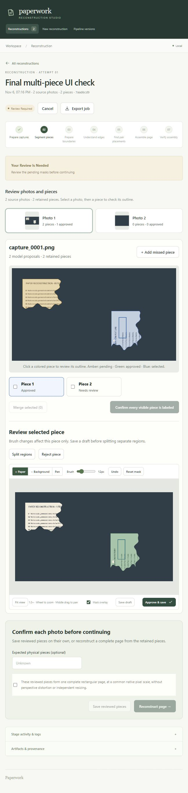

# Multi-piece integration validation — 6 November 2026

Application `0.2.0` integrates the exact Stage 1 v2.5.0 release `be0393b0fe72c00bebda8c17f35ccda170b600e3`. Stage 2/3/4 sources, models and algorithms remain unchanged. The composition lock SHA-256 is `02152420a32ffd0571e99ecedf96428c40a3115fef859b80cf5f8a036dc9d522`.

## Automated and real-model checks

38 tests passed on Windows Python 3.14 and in the Linux Python 3.14 CI environment. Tests exercise zero/one/several observations per source, per-piece artifact isolation, raw-publication immutability, overlapping bounding boxes versus overlapping mask pixels, stale revisions, manual additions, reject/restore, split/merge lineage, source confirmations, expected physical counts, segmentation-only continuation, empty completion and older-image worker claims. Native materialization, connected-component handling and publication verification use the actual Stage 1 package.

The TypeScript/production Vite build, Python lint and source whitespace checks passed. The Linux CI test command installs Stage 1 at the locked source commit rather than depending on an ignored research checkout.

Four complete controls used the actual HTTP API, coordinator, installed CPU packages/models and native assessment with `--network none`, a read-only application filesystem and isolated data volumes:

| Control | Observed result | Time |
| --- | --- | --- |
| Four separate photos, flagged review, deliberate Stage 3 cancellation/resume | Supported; four pieces, three joins, connected; authenticated resume verified | 136.219 s |
| Four separate photos, review-all and one-native-pixel correction | Supported; four pieces, three joins, connected | 110.294 s |
| Two photos containing two pieces each, plus a blank photo; review-all and one-native-pixel correction | Real model proposed 2 + 2 + 0; explicit empty confirmation; supported four-piece assembly | 116.638 s |
| Blank photo only | Explicit empty confirmation; completed `no_pieces`, zero physical observations; no Stage 2–4 | 11.172 s |

Receipts: [cancellation/resume](validation/multi-piece/cancellation-resume.json), [separate photos with correction](validation/multi-piece/separate-review.json), [multi-piece photos](validation/multi-piece/multi.json), [empty photo](validation/multi-piece/empty.json). Times include workflow overhead on this workstation and are not throughput guarantees.

The four-stage controls ran in image `sha256:00547f309c1f051f2eb704fb03b83b78aef2e6d744350c3b9334a225b8c4edb2`. A subsequent CSS-only correction scoped sidebar navigation styles so photo counts remain visible. The promoted image is `sha256:71f91af78800a0ba8a0ccf2688246e3770039b01455bfdfba7c0b491a42423fb`. Its application/runtime identity `5b1cfc58856d8fdb2b50917a4a315a706b564b1299b72789e24a3d73ad3248ae` and composition lock were independently checked to match all four receipts exactly. No stage or coordinator code changed between these images; the corrected UI was checked in the browser.

## Browser and existing-data checks

The browser test uploaded a photo containing two pieces and a blank photo without a complete-page declaration. It selected and independently approved pieces, rejected/restored the second proposal, confirmed both sources including the empty source, and saved two native crops without reconstruction. The saved result exposed a later reconstruction action. The final UI also blocked photo/piece switching while an outline had unsaved changes and released those controls after saving. The screenshot shows the corrected photo counts and selected-piece editor:

The promoted app is healthy at `http://localhost:8000`, using the existing `paper-orchestrator-data` volume. All six existing jobs were retained. Three historical completed jobs' piece/review endpoints were successfully read; jobs from older image identities remain viewable/exportable and require their original image to resume or edit. See [running application receipt](validation/multi-piece/running.json).

The original application image is retained under `paper-orchestrator:legacy-before-multi-0.2.0`; the previous local tag is also retained. All containers and volumes created for these migration controls/browser checks were removed. The main app and user data were retained.

## Scope

This validates multi-piece packaging, review semantics, identities and four-stage interoperability on generated controls. It does not establish segmentation accuracy on unseen real photographs or change Stage 3/4 performance.

## Published source and image download

The implementation and updated README are pushed to `main`; source tag `v0.2.0` points to `6278413d9690c060cb815d5192b4f2b704b95050`. The [v0.2.0 release](https://github.com/DanielKatzman/orchestrator/releases/tag/v0.2.0) distributes the locally qualified image above as a self-contained ZIP with Compose, generated samples and qualification receipts. No private run photographs or evidence ZIPs are included.

The ZIP is 664,444,184 bytes with SHA-256 `3792bbaf1925dec243d6c4a3dd26e74f944b93ada85b2a66d5df7814fb69823b`. GitHub's full uploaded-asset digest matches that checksum. An anonymous range download returned HTTP 206 and a valid ZIP header. The embedded image archive was loaded successfully and independently checked to retain the exact qualified image ID `sha256:71f91af78800a0ba8a0ccf2688246e3770039b01455bfdfba7c0b491a42423fb`.

Registry publication remains pending. The hosted qualification job did not start, so these results are the existing Windows/Linux local tests and offline image controls, not a claimed hosted-CI pass. Use the release ZIP and `compose.download.yaml` until the registry route is published. See the [release receipt](validation/github-release-0.2.0.json).
